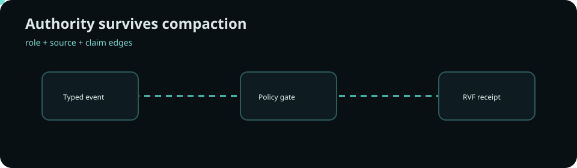
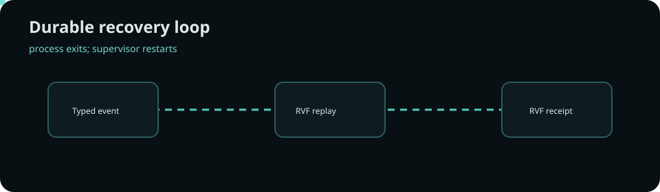

# Context Bastion

**Provenance-safe context compaction and action governance for tool-using agents.**

Long sessions need compression, but flat summaries can turn a tool quotation into apparent user authority. Context Bastion preserves typed source lineage, shows operators exactly why an action is allowed or denied, and recovers the complete audit from RVF after a real service restart.

## Product

- Command workbench for typed user/tool/assistant evidence
- Claim-level provenance graph with laundering markers
- RuVector semantic recall that cannot elevate trust
- Microsoft Regorus plus native policy agreement
- Exact-event high-risk approvals and idempotent receipts
- Append-only RVF snapshots and supervised restart recovery

## Quickstart

Run: ./scripts/bootstrap.sh && ./scripts/start.sh

Open http://127.0.0.1:4173; API is http://127.0.0.1:8787 and health is /healthz. Stop with ./scripts/stop.sh. The deterministic seed/reset commands use an isolated synthetic namespace.

## Acceptance workload

The primary journey compacts authentic intent and tool evidence, recalls claims with RuVector, evaluates through Regorus, appends to RVF, and renders the effect receipt. The denial journey proves a forged user-approval string produces no effect. The recovery journey exits and restarts the backend, then reloads the audit from RVF.

## Composition and results

| Ingredient | Responsibility | Removal effect |
|---|---|---|
| RuVector 2.4.0 | semantic claim analogues | recall coverage falls to zero |
| RVF runtime 0.4.0 | durable session/archive | restart retrieval fails |
| Microsoft Regorus 0.5.0 | enterprise policy evaluation | dual-engine agreement absent |
| Typed claim provenance | compaction safety | forged-approval resistance collapses |

Measured benchmark and ablation results are generated by scripts/benchmark.sh and scripts/ablations.sh; exact immutable results live in the CI evidence artifact, never as unsupported README claims.

## Architecture and evidence

The workspace has 23 independently counted meaningful Rust crates plus 2 supporting adapter crates connected through [architecture](docs/architecture.md), [25 decisions](docs/adr/README.md), and [12 bounded-context documents](docs/ddd/README.md). Read the [research](docs/research.md), [acceptance map](docs/prototype-acceptance.md), [traceability](docs/traceability.md), and [security boundary](docs/security.md).

## Maturity

This is a synthetic, test-namespaced research prototype. The local bearer fixture, local RVF directory, and test-only restart endpoint are not production authentication or persistence. Cloud Run configuration is deployment-compatible, but no cloud deployment, spend, customer data, or production readiness is claimed.
